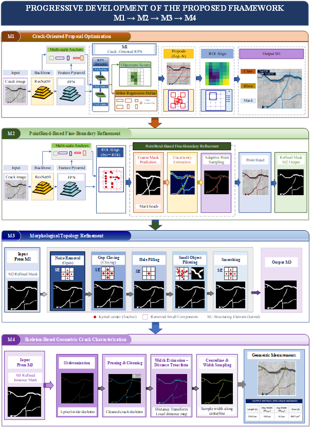
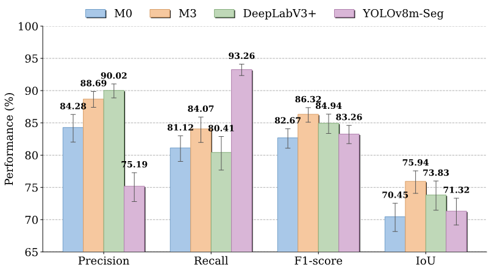
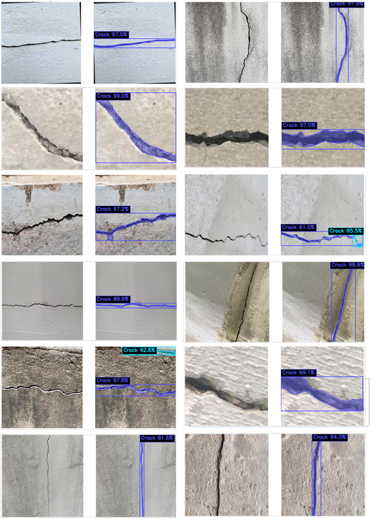
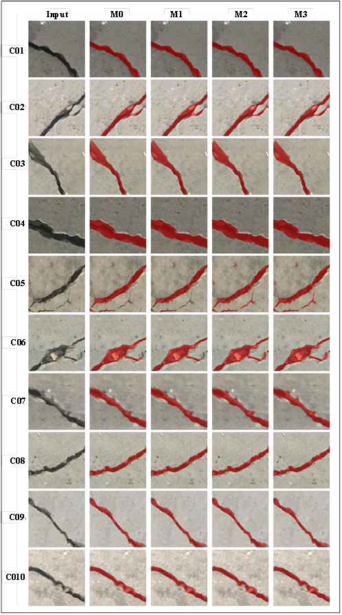
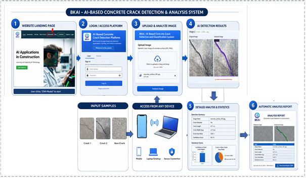

<div align="center">

# An integrated mask R-CNN framework for concrete crack segmentation and skeleton-based quantification in automated infrastructure inspection

### Published Research | Springer Nature | 2026

**Dat-Thanh Nguyen · Nhat-Quang Tran · Duc-Hoc Tran**

*Journal of Building Pathology and Rehabilitation*  
**Volume 11 · Article 228 · 2026**

[](https://doi.org/10.1007/s41024-026-00900-z)
[](https://doi.org/10.1007/s41024-026-00900-z)

**Mask R-CNN · ResNet-50-FPN · PointRend · Morphological Refinement · Skeletonization**

**[READ THE FULL PUBLISHED ARTICLE](https://doi.org/10.1007/s41024-026-00900-z)**

</div>

---

## Research Overview

Automated concrete crack inspection is essential for infrastructure condition assessment and maintenance planning.

This research presents a progressive Mask R-CNN framework integrating crack-oriented proposal adaptation, fine-boundary refinement, morphological topology refinement, and skeleton-based geometric characterization.

The framework is developed to improve the representation of irregular and elongated crack patterns while supporting quantitative image-based analysis.

Experimental evaluation includes successive model configurations and controlled comparisons with established segmentation methods. The associated BKAI research application demonstrates crack visualization, geometric characterization, and inspection-oriented reporting.

> **About this repository:** This repository serves as a research showcase for the published study. It provides selected findings, visual demonstrations, and links to related research resources. The complete methodology, experimental protocols, and scientific discussion are available in the peer-reviewed journal article.

---

## Research Highlights

The study focuses on four main contributions:

**1. Progressive Crack Segmentation**

A Mask R-CNN framework progressively incorporating crack-oriented proposals, boundary refinement, and topology refinement.

**2. Controlled Performance Evaluation**

Comparison of successive model configurations and established segmentation architectures using defined experimental protocols.

**3. Skeleton-Based Geometric Characterization**

Extraction of crack centerlines and pixel-domain geometric descriptors from refined instance masks.

**4. Engineering-Oriented Application**

Integration of segmentation and quantitative analysis into a BKAI research demonstration for infrastructure inspection.

---

## Proposed Framework

The framework comprises five configurations, from the Mask R-CNN baseline to crack-oriented geometric characterization.

| Stage | Configuration | Main Purpose |
|:---:|---|---|
| **M0** | Baseline Mask R-CNN | Instance segmentation |
| **M1** | Crack-Oriented Proposal Adaptation | Crack-specific region proposals |
| **M2** | PointRend Refinement | Fine-boundary refinement |
| **M3** | Morphological Topology Refinement | Mask continuity and topology |
| **M4** | Skeleton-Based Geometric Characterization | Centerline and width analysis |

<div align="center">



*Progressive development of the proposed framework (M1–M4). M0 serves as the baseline.*

</div>

The framework integrates established components within a progressively refined instance-aware processing pipeline. The complete technical architecture is described in the published article.

---

## Selected Experimental Results

The study uses separate experimental protocols for progressive framework development and controlled cross-model evaluation.

### Controlled TEST1007 Evaluation

The proposed **M3** configuration achieved:

| Metric | M3 Result |
|:---|---:|
| Precision | **88.69%** |
| Recall | **84.07%** |
| F1-score / Dice | **86.32%** |
| Intersection over Union (IoU) | **75.94%** |

### Model Comparison

<div align="center">



*Comparison of M0, M3, DeepLabV3+, and YOLOv8m-Seg under the controlled TEST1007 protocol.*

</div>

Under this protocol, M3 achieved the highest F1-score and IoU among the compared models.

DeepLabV3+ demonstrated higher precision, while YOLOv8m-Seg achieved higher recall, reflecting different segmentation performance trade-offs.

Results from the controlled test protocol should not be directly interchanged with those from the development experiments.

**[Explore Selected Experimental Results](results/README.md)**

For full comparative tables, component analyses, experimental settings, and scientific interpretation:

**[Read the Journal Article](https://doi.org/10.1007/s41024-026-00900-z)**

---

## Visual Demonstrations

### Concrete Crack Detection and Segmentation

<div align="center">



*Representative crack detection and instance segmentation results.*

</div>

### Progressive Mask Refinement

<div align="center">



*Representative qualitative comparison of the M0–M3 configurations.*

</div>

These examples illustrate the representation and refinement of crack regions across the proposed framework.

Further qualitative evaluations and detailed observations are provided in the published research.

---

## Geometric Crack Characterization

The M4 stage extends refined segmentation masks toward image-based geometric characterization.

The main processing operations include:

- Skeletonization of refined crack masks
- Centerline extraction and characterization
- Distance-transform-based crack width estimation
- Crack-wise quantitative geometric analysis

**Measurement scope:** Without camera calibration or an appropriate physical reference scale, the estimated crack lengths and widths remain pixel-domain measurements and must not be interpreted as absolute physical dimensions.

Detailed quantitative results and measurement assumptions are available in the publication.

---

## BKAI Research Application

The BKAI research application demonstrates the integration of AI-based concrete crack analysis into an inspection-oriented workflow.

Selected functions include:

- Concrete crack image analysis
- Predicted mask visualization
- Individual crack identification
- Image-based geometric measurements
- Quantitative analysis and graphical summaries
- Structured inspection reports

<div align="center">



*BKAI AI-based concrete crack analysis and reporting workflow.*

</div>

The BKAI application is a research-oriented demonstration. Its outputs do not replace calibrated physical measurements or professional structural safety assessments.

### Related Resources

| Resource | Link |
|---|---|
| BKAI Research Website | [Visit Website](https://bkai.b12sites.com/index) |
| BKAI AI Application | [GitHub Repository](https://github.com/ndtnguyen260696/bkai-ai-app) |
| Research Dataset | [Roboflow Dataset](https://universe.roboflow.com/thanh-nguyen-ws5r9/concrete-crack-dfd3i) |
| Selected Experimental Results | [Results Directory](results/README.md) |
| Published Research Article | [Springer Nature](https://doi.org/10.1007/s41024-026-00900-z) |

---

## Repository Organization

The repository is organized primarily to support research presentation and access to selected associated materials.

```text
BKAI-Model-Mask-R-CNN/
|
|-- README.md
|-- LICENSE
|
|-- assets/
|   `-- images/
|       `-- bkai_paper_2026/
|           |-- fig06_progressive_m1_m4.png
|           |-- fig15_crack_prediction_examples.png
|           |-- fig17_m0_m3_qualitative_masks.png
|           |-- fig20_test1007_comparison.png
|           `-- fig21_bkai_web_workflow.png
|
`-- results/
    `-- README.md
```

The displayed structure focuses on research documentation and selected figures. Availability of executable code, trained model checkpoints, and full experimental resources should be verified independently.

---

## Publication and Citation

### Official Journal Publication

**Nguyen, D.-T., Tran, N.-Q., & Tran, D.-H. (2026).**

An integrated mask R-CNN framework for concrete crack segmentation and skeleton-based quantification in automated infrastructure inspection.

*Journal of Building Pathology and Rehabilitation, 11*, Article 228.

**DOI:** https://doi.org/10.1007/s41024-026-00900-z

### BibTeX

```bibtex
@article{Nguyen2026IntegratedMaskRCNN,
  author  = {Nguyen, Dat-Thanh and Tran, Nhat-Quang and Tran, Duc-Hoc},
  title   = {An integrated mask R-CNN framework for concrete crack segmentation and skeleton-based quantification in automated infrastructure inspection},
  journal = {Journal of Building Pathology and Rehabilitation},
  year    = {2026},
  volume  = {11},
  pages   = {228},
  doi     = {10.1007/s41024-026-00900-z},
  url     = {https://doi.org/10.1007/s41024-026-00900-z}
}
```

---

## Copyright and Research Use

This repository contains research descriptions, selected experimental figures, and supporting materials associated with the published study.

Reuse of repository materials is subject to applicable copyright notices, prior licenses, publisher agreements, and third-party rights.

The published journal article is governed by the relevant Springer Nature publication agreement.

Please consult the repository's [LICENSE](LICENSE) file for its current copyright and usage notice.

---

## Contact

**Dat-Thanh Nguyen**

Ho Chi Minh City University of Technology (HCMUT)  
Vietnam National University Ho Chi Minh City  
Vietnam

**Academic Email:** ndthanh.sdh231@hcmut.edu.vn

**GitHub:** https://github.com/bkai-ndt-sdh231

---

<div align="center">

### Full Research Publication

For the complete methodology, controlled experiments, quantitative findings, and scientific discussion:

**[READ THE FULL ARTICLE ON SPRINGER NATURE](https://doi.org/10.1007/s41024-026-00900-z)**

*Journal of Building Pathology and Rehabilitation · 2026*

---

**BKAI — AI-Based Concrete Crack Segmentation and Quantification**

</div>
